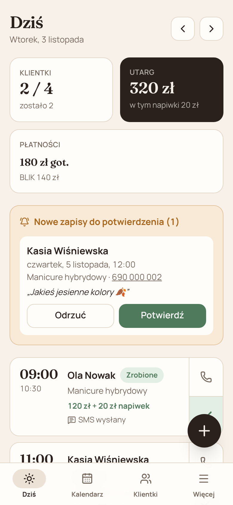
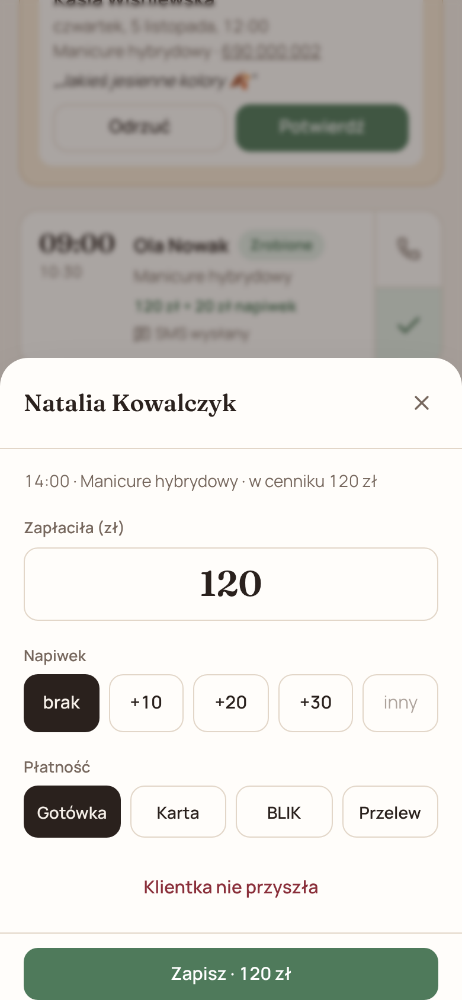
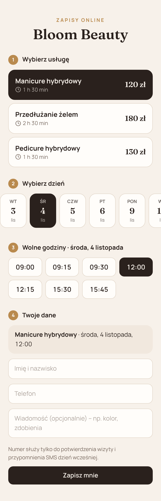
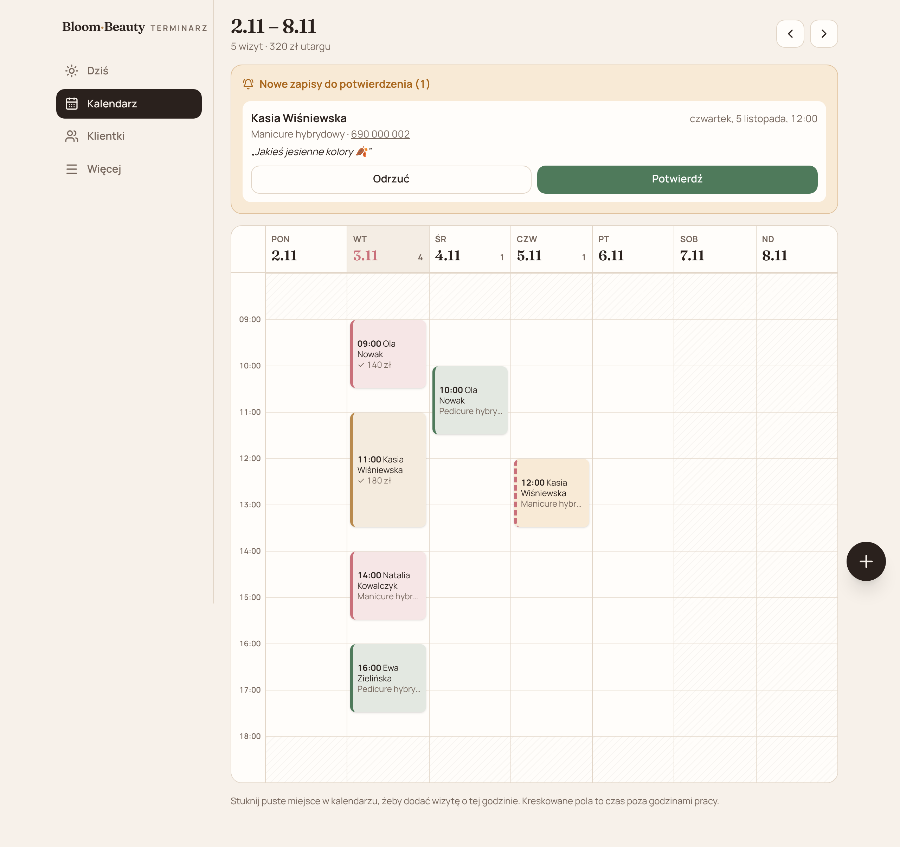
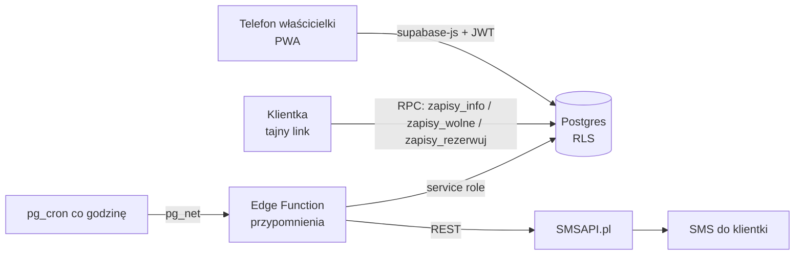

# Terminarz Bloom Beauty

Aplikacja, która zastępuje papierowy kalendarz w salonie paznokci [Bloom Beauty](https://bloombeauty.com.pl) w Oświęcimiu.
Właścicielka zapisuje w niej wizyty i odhacza klientki. Kwotę z wizyty wpisuje dwoma tapnięciami i od razu widzi utarg dnia.
Znajome klientki zapisują się same przez tajny link, a dzień przed wizytą dostają SMS z przypomnieniem.

> Projekt zbudowany dla prawdziwego salonu, który wcześniej korzystał z papierowego terminarza. Celem było **jak najbardziej skrócić i uprościć** codzienną pracę właścicielki.

| Dziś | Po klientce | Zapisy przez link |
| --- | --- | --- |
|  |  |  |



## Co potrafi

- **Dziś**: lista wizyt z liczbą zrobionych klientek, utargiem, napiwkami i podziałem na gotówkę, kartę i BLIK.
  „✓” otwiera okienko z kwotą (domyślnie cena z cennika), napiwkiem i formą płatności.
- **Kalendarz tygodnia** pokazuje wizyty w kolorach usług, godziny pracy i urlopy. Stuknięcie w puste pole dodaje wizytę na tę godzinę.
- **Klientki**: wyszukiwanie po imieniu albo numerze, notatki (kolor, kształt, alergie), historia wizyt, suma wydatków i nieobecności.
- **Usługi i cennik**: czas trwania i cena same uzupełniają się w nowej wizycie.
- **Zapisy przez tajny link** (à la Booksy, tylko dla znajomych):
  - klientka wybiera usługę, dzień i wolną godzinę;
  - nie widzi danych innych osób;
  - zapis trafia do salonu jako „do potwierdzenia”;
  - link można w każdej chwili wyłączyć albo wygenerować nowy.
- **Przypomnienia SMS** dzień przed wizytą o wybranej godzinie, z własnym szablonem treści i podglądem liczby znaków.
- **Podsumowanie** tygodnia i miesiąca: utarg dzień po dniu, średnia na klientkę, odsetek nieobecności, najlepsze usługi.
- **PWA**: aplikację można dodać do ekranu głównego telefonu i działa jak natywna.

## Technologie

| Warstwa | Wybór |
| --- | --- |
| Frontend | React 19, TypeScript (strict), Vite, Tailwind CSS v4, TanStack Query, React Router |
| Backend | Supabase: Postgres, Auth, Row Level Security, Edge Functions (Deno), pg_cron + pg_net |
| SMS | [SMSAPI.pl](https://www.smsapi.pl) (REST); bez klucza działa tryb testowy |
| Jakość | Vitest, GitHub Actions (typy, testy, build), automatyczna publikacja na GitHub Pages |

## Architektura



### Ciekawsze rozwiązania

- **Dwie wizyty nie mogą się nałożyć.** Pilnuje tego sama baza: ograniczenie `EXCLUDE USING gist` na `tstzrange(start, koniec)`
  (rozszerzenie `btree_gist`). Działa także wtedy, gdy klientka zapisuje się przez link w tej samej sekundzie, w której właścicielka wpisuje wizytę.
- **Zapisy bez logowania, ale bez dostępu do danych.**
  - Rola `anon` nie ma prawa odczytu żadnej tabeli.
  - Ma tylko trzy funkcje `SECURITY DEFINER`, które sprawdzają token, zwracają wyłącznie wolne godziny i ponownie weryfikują termin przy rezerwacji.
  - Limity przeciw nadużyciom: najwyżej 3 oczekujące zapisy na numer i 20 zapisów na godzinę na salon.
- **Strefa czasowa.**
  - Wszystkie daty liczone są w strefie salonu (`Europe/Warsaw`), niezależnie od ustawień telefonu.
  - Testy obejmują dni zmiany czasu (`src/lib/czas.test.ts`).
- **SMS wychodzi raz.**
  - Funkcja oznacza wizytę warunkowo (`… where sms_status = 'brak'`).
  - Przy zmianie godziny wizyty trigger kasuje status, więc przypomnienie wyjdzie ponownie z nową godziną.
  - Polskie znaki są zamieniane na łacińskie, bo wiadomość mieści wtedy 160 znaków zamiast 70.
- **Cron bez ujawniania kluczy.** pg_cron wysyła losowy klucz z prywatnego schematu (`prywatne.klucze`), którego nie widać przez API.
- **Uprawnienia.** Każda tabela ma RLS z polityką `salon_id in (select moje_salony())`, więc jedno konto widzi wyłącznie swój salon.

## Struktura

```
src/
  lib/          czas, pieniądze, SMS (czysta logika + testy), klient Supabase, hooki danych
  components/   formularze wizyt, karta wizyty, okno modalne, nawigacja
  pages/        Dziś, Kalendarz, Klientki, Usługi, Godziny, Link, SMS, Podsumowanie, Zapisy (publiczne)
supabase/
  migrations/   schemat, RLS, funkcje RPC, cron
  functions/    przypomnienia (Edge Function, Deno)
```

## Uruchomienie lokalnie

```bash
cp .env.example .env   # uzupełnij adres i klucz publishable projektu Supabase
npm install
npm run dev            # http://localhost:5173
npm test               # testy jednostkowe
```

Bazę tworzą migracje z `supabase/migrations` (w kolejności). Funkcję `supabase/functions/przypomnienia` wdraża się z wyłączoną weryfikacją JWT, bo sama sprawdza klucz crona.
Prawdziwe SMS-y wymagają sekretu `SMSAPI_TOKEN`; bez niego funkcja działa w trybie testowym.

## Plany

- [x] Etap 1: kalendarz, dzień pracy z utargiem, klientki, zapisy przez link, przypomnienia SMS
- [ ] Etap 2: zdjęcia po wizycie (6 zdjęć tworzy kolaż automatycznie)
- [ ] Etap 3: publikacja kolażu na Instagramie (Instagram Graph API)

## Licencja

MIT
